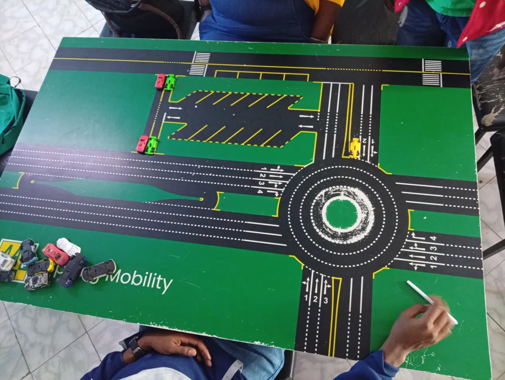

# Kenyan Model Town Board Simulator (NTSA Official Curriculum)

An interactive, accurate web simulator and pathfinding trainer for the **Kenyan Model Town Board (MTB)**, modeled after the official **NTSA / AA Kenya Mobility** curriculum and driving test standards.



---

## 🌟 Features

- **Accurate Model Town Board Layout**:
  - Central 4-ring concentric roundabout with clockwise circulation rules.
  - Symmetrical tapered central turning point island with yellow convex end-caps and concave scoop medians.
  - Authentic painted directional road arrows following the NTSA **2 - 1 - 2 - 4** rule for Major Roads and **2 - 1 - 2** for Minor Roads.
  - Flush / parallel uncontrolled parking & controlled angle parking with reverse-in / reverse-out rules.
  - Pedestrian crossings (zebra stripes) and perimeter two-way single carriageway roads.

- **NTSA Exam Rules Engine & BFS Solver**:
  - Breadth-First Search (BFS) pathfinding algorithm that computes the shortest legal NTSA routes.
  - Strict NTSA rule enforcement:
    - Rule 1: Use the shortest and most correct route without using parking.
    - Rule 2: Use the longest and most correct route without using parking (when primary route is blocked).
    - Rule 3: Use parking as a last resort.
    - Roundabout rules: strict clockwise movement, no lane shifting inside roundabout rings, correct entry-to-ring mapping.
    - Broken white line vs solid white line shifting rules.

- **10 Interactive NTSA Driving Exam Challenges**:
  - Step-by-step guidance, real-time violation diagnosis, animated solutions, and instructor hints.

- **Modular Architecture**:
  - `src/data/boardGraph.js`: Nodes, edges, zones, and road coordinates.
  - `src/data/challenges.js`: 10 official NTSA challenges and solutions.
  - `src/engine/bfsSolver.js`: Pure BFS pathfinder & rule validation engine.
  - `src/components/BoardCanvas.jsx`: High-performance SVG tabletop renderer with interactive toy cars.
  - `src/components/InstructorPanel.jsx`: Challenge selection, step diagnosis, and solution playback.

---

## 🚀 Getting Started

### Prerequisites
- Node.js (v18 or higher recommended)
- npm

### Installation
```bash
# Clone the repository
git clone https://github.com/JOHN-ITDEVELOPER/kenya-model-town.git

# Navigate into the project folder
cd kenya-model-town

# Install dependencies
npm install

# Start the Vite development server
npm run dev
```

### Build for Production
```bash
npm run build
npm run preview
```

---

## 🛠️ Tech Stack
- **React 18**
- **Vite**
- **Tailwind CSS**
- **Lucide React Icons**
- **SVG Vector Graphics**

